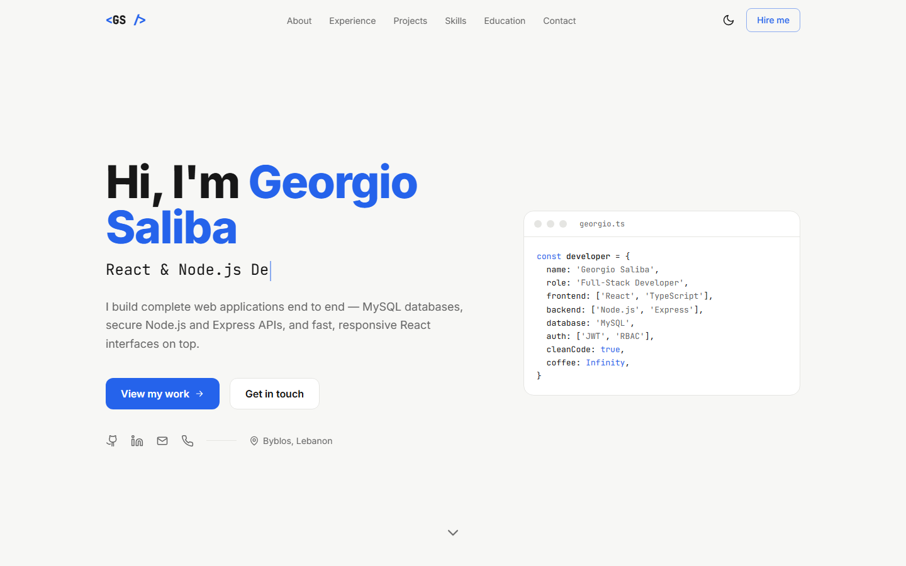
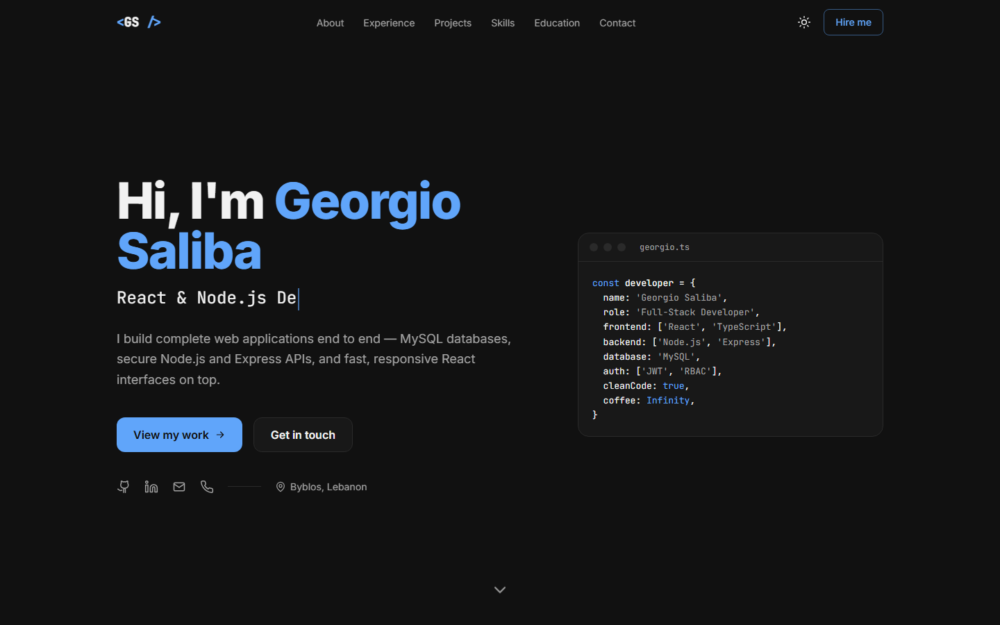

# Georgio Saliba — Portfolio

A one-page portfolio for **Georgio Saliba**, Full-Stack Developer (React · TypeScript · Node.js · Express · MySQL).

Scroll past the hero and the projects move through a quiet 3D space: the one in front recedes to the side as the next one comes forward. Click a project and it opens in a lightbox with its own gallery, links and source.

**🔗 Live demo: [georgio-saliba-portfolio.vercel.app](https://georgio-saliba-portfolio.vercel.app/)**



<details>
<summary>Dark mode</summary>



</details>

## Features

- **Project island (hero):** a small three.js world with one landmark per project. Click or tap the island to roll a ball there, or use arrows / WASD once it has focus; arriving at a landmark lights it up, and clicking it again (or Enter) opens that project's case study. The labels over the landmarks are real buttons, so Tab walks the island too, and arrivals are announced to screen readers. three.js loads in its own chunk after first paint, the scene pauses when it's off screen or the tab is hidden, follows the theme, and sits on the opposite side in Arabic. With *prefers-reduced-motion* the ball jumps instead of rolling and nothing idles; without WebGL the hero is simply text
- **Headline motion:** the hero headline and every section title rise word by word out of a mask, once, as they come into view (off with reduced motion)
- **Easing lab (Under the hood):** race a per-frame easing against the site's time-based `ease()` at 30, 60, 120 or 144 fps, with the code and its live numbers next to it
- **3D scroll gallery:** projects are placed with CSS 3D transforms driven by scroll position (no animation or 3D library), eased toward the scroll for a smooth glide. Cards further back sit in a soft haze, the scene leans toward the mouse with a light that follows it, and each card tilts and catches a sheen on hover. Phones get a flatter, shallower version; *prefers-reduced-motion* gets a plain list
- **Filters and progress:** filter chips by category (full-stack, mobile, front-end), plus a "built with" filter set from a case study's technology tags. A segmented progress bar shows which project is at the front, and each segment jumps to its project
- **Case studies:** clicking a card morphs it into its case study (View Transitions, where supported). Each one has a screenshot gallery (arrows, dots, swipe, keyboard), an overview, an "at a glance" stats panel, the problem and approach, technical challenges, an architecture diagram you can step through, interactive demos and the result, with a sticky section nav. Escape closes it; the page behind is locked, keeps its scroll position and gets focus back
- **Real numbers only:** stats come from the project data (technology and layer counts, plus checkable facts). This site's own case study adds first paint, load time and JavaScript size measured in the visitor's browser, and a PNG-vs-WebP comparison with file sizes measured live
- **Interactive demos:** a before/after of role checks in the interface vs on the server (Saliba Polyclinic), a mini store from browsing to checkout (Iverse), loading / empty / error states (Recipe Finder), and the gallery's own placement function on a slider (this site). Each is labelled as a sketch with sample data
- **Technology tags:** pick a technology in a case study to see which other projects use it, jump to one, or filter the gallery by it
- **Interactive About:** tabs for what I'm building, what I'm experimenting with and the technologies I enjoy; pick a technology to see which projects and jobs used it (worked out from the project and CV data, so it stays true)
- **Now:** a small dated note on what's happening at the moment
- **Play:** a small Snake game where every bite is one of the tools I work with. Smooth, frame-interpolated movement on a fixed game clock, three paces (Chill wraps through walls, Classic, Challenge), timed star bites for bonus points, particles and an optional synthesised sound (no audio files), start / pause / game-over menus with instant restart, and confetti for a new personal best. Arrow keys, WASD, swipes (several turns per gesture) or on-screen buttons that react on touch-down; invalid reverse turns are ignored; a short count-in after a pause; pauses by itself when scrolled out of view or the tab is hidden; results announced to screen readers and effects dropped for *prefers-reduced-motion*; best score per pace kept on the device
- **Ask about me:** a small floating chat with five ready-written questions and answers about Georgio (no AI and no API key), each with a button to the right section. Keyboard accessible, answers announced to screen readers, follows the language switch
- **Minesweeper (in Play):** the mines are bugs. Beginner (9 × 9, 10 bugs), Intermediate (12 × 12, 24) and Expert (15 × 15, 45), always with a safe first click. Empty areas ripple open, flags drop in, bugs pop up after a loss, and a new record gets confetti; optional synthesised sound (no audio files). Start screen, a three-step tutorial on the first visit, pause (the board hides while the clock is stopped), and a summary with the time, best time and bugs flagged correctly, plus Play again. Mouse (right-click to flag, click a number to open around it), keyboard (arrows, Enter, F, P, N) and touch (long press with a fill-up hint, or flag mode). The clock runs on timestamps and pauses itself when the board leaves the screen; best time per board kept on the device
- **Under the hood:** performance, responsive design, accessibility, three languages, Arabic RTL, the problems solved along the way, and a live readout of this visit (viewport, language and direction, theme, motion setting, first paint, load time, JavaScript size) read from the browser
- **Per-project links:** "Live website" and "View source on GitHub" point to that project's own site and repository, and are only shown when they exist
- **English, French and Arabic:** a language switcher in the navbar, remembered per visitor (first visits follow the browser language). Arabic is fully right to left: mirrored layout and arrows, direction-aware gallery swipes and arrow keys, and Arabic fonts (IBM Plex Sans Arabic, Amiri). Built in, with no i18n library
- **Light / dark mode:** light by default (dark if the system prefers it), remembers the visitor's choice, no flash on load
- **Responsive images:** screenshots are served as WebP at 800 and 1600 px and lazy-loaded; a project can mark one screenshot as its phone version for the portrait card on small screens
- **Sharing and search:** link preview image and tags, structured data about Georgio, a custom 404 page and a skip-to-content link

## Adding a project

1. Put the original screenshots (PNG or JPG) in `images-src/projects/`, e.g. `my-app-home.png`.
2. Run `npm run images`. It writes `my-app-home-800.webp` and `my-app-home-1600.webp` to `public/images/projects/`.
3. Add an entry to [`src/data/projects.js`](src/data/projects.js):

```js
{
  slug: 'my-app',
  title: 'My App',
  year: '2026',
  type: 'Web app',
  summary: 'One line for the card.',
  description: 'A few sentences for the lightbox.',
  technologies: ['React', 'TypeScript'],
  screenshots: [
    { name: 'my-app-home', alt: 'Home page showing ...' },
    { name: 'my-app-phone', alt: 'The app on a phone', phone: true }, // optional
  ],
  github: 'https://github.com/georgio30/my-app', // or null
  live: 'https://my-app.example.com',          // or null
  tone: '#ece8df',
}
```

Add a `caseStudy` to tell the story. `approach` is a list of steps and `challenges` a list of `{ title, text }`:

```js
caseStudy: {
  problem: { en: '...', fr: '...', ar: '...' },
  approach: { en: ['Step one', 'Step two'], fr: ['...'], ar: ['...'] },
  challenges: [{ title: { en: '...' }, text: { en: '...' } }],
  result: { en: '...', fr: '...', ar: '...' },
},
```

A few more optional fields feed the gallery and the case study:

```js
category: 'fullstack', // one of the ids in `categories`, for the filter chips
facts: [{ value: '3', label: { en: 'core records' } }], // real, checkable numbers only
layers: [{ name: 'API', items: ['Node.js', 'Express'] }], // the architecture diagram
demos: ['access'], // interactive demos, see src/components/ProjectDemos.jsx
```

A project with no screenshots gets a generated cover (and a "how it's put together" panel if it has `layers`).

To translate a field, give it one value per language instead of a string. Anything left as a plain string is shown as-is in every language, and a missing language falls back to English:

```js
summary: {
  en: 'One line for the card.',
  fr: 'Une ligne pour la carte.',
  ar: 'سطر واحد للبطاقة.',
},
```

## Keeping the site current

- [`src/data/now.js`](src/data/now.js): the "Now" note (change `nowUpdated` when you edit it) and the About tabs.
- [`src/data/craft.js`](src/data/craft.js): the "Under the hood" points and challenges.
- [`src/data/chat.js`](src/data/chat.js): the chat's questions and answers.

## Translations

- Interface text (nav, buttons, headings, labels) lives in [`src/i18n/en.js`](src/i18n/en.js), [`fr.js`](src/i18n/fr.js) and [`ar.js`](src/i18n/ar.js). Each file has the same keys.
- Project and CV text is translated next to the data, in [`src/data/projects.js`](src/data/projects.js) and [`src/data/resume.js`](src/data/resume.js), using the `{ en, fr, ar }` form above.
- Components read both through the `useI18n()` hook: `t` for interface text, `pick(field)` for data fields.
- For right-to-left support, use logical Tailwind classes (`ms-`, `ps-`, `start-`, `text-start`) instead of left/right ones, and `rtl:` variants where something must flip (for example `rtl:-scale-x-100` on an arrow).

## Tech stack

| | |
|---|---|
| Framework | [React 19](https://react.dev) + [Vite](https://vite.dev) |
| Styling | [Tailwind CSS v4](https://tailwindcss.com) |
| Images | [sharp](https://sharp.pixelplumbing.com) (dev only, for `npm run images`) |
| Linting | [oxlint](https://oxc.rs) |

## Getting started

Requires [Node.js](https://nodejs.org) 20 or newer.

```bash
git clone https://github.com/georgio30/georgio-saliba-portfolio.git
cd georgio-saliba-portfolio
npm install
npm run dev
```

Then open http://localhost:5173.

| Script | What it does |
|---|---|
| `npm run dev` | Start the dev server with hot reload |
| `npm run build` | Build for production into `dist/` |
| `npm run preview` | Preview the production build locally |
| `npm run lint` | Lint the code |
| `npm run images` | Turn screenshots in `images-src/projects/` into responsive WebP |

## Project structure

```
src/
├── App.jsx                 # Page layout
├── index.css               # Tailwind theme tokens (light & dark)
├── data/
│   ├── projects.js         # Every project shown in the gallery, with its case study
│   ├── resume.js           # Profile, experience, skills
│   ├── now.js              # The Now note and the About tabs
│   └── craft.js            # Under-the-hood points and challenges
├── i18n/
│   ├── index.jsx           # Language provider and useI18n() hook
│   └── en.js, fr.js, ar.js # Interface text per language
├── lib/                    # Shared hooks, gallery helper and the 3D stage maths
└── components/
    ├── Navbar.jsx          # Sticky nav, active section, scroll progress
    ├── Hero.jsx
    ├── Experience.jsx      # The internships, told briefly
    ├── ProjectShowcase.jsx # The 3D scroll gallery
    ├── ProjectCard.jsx     # One project in the gallery (hover depth)
    ├── ProjectCover.jsx    # Generated cover for projects without screenshots
    ├── ProjectModal.jsx    # Lightbox
    ├── ProjectGallery.jsx  # Screenshots inside the lightbox (swipe, dots, arrows)
    ├── About.jsx
    ├── AboutTabs.jsx       # Building / Experimenting / Technologies
    ├── Now.jsx
    ├── Play.jsx            # Game switcher (Snake, Minesweeper)
    ├── Snake.jsx           # Snake: menus, controls, React wiring (engine and drawing in lib/snake.js)
    ├── Craft.jsx           # Under the hood, with the live readout
    ├── Chat.jsx            # The floating "ask about me" chat
    ├── Contact.jsx
    ├── Footer.jsx
    ├── LanguageSwitcher.jsx # EN · FR · ع in the navbar
    └── ...                 # Section, Reveal, Screenshot, ThemeToggle, Icons
scripts/optimize-images.mjs
images-src/projects/        # Original screenshots
```

## Contact

- GitHub: [@georgio30](https://github.com/georgio30)
- LinkedIn: [Georgio Saliba](https://lb.linkedin.com/in/georgio-saliba-30265a2b4)
- Email: [georgiosaliba@hotmail.com](mailto:georgiosaliba@hotmail.com)
